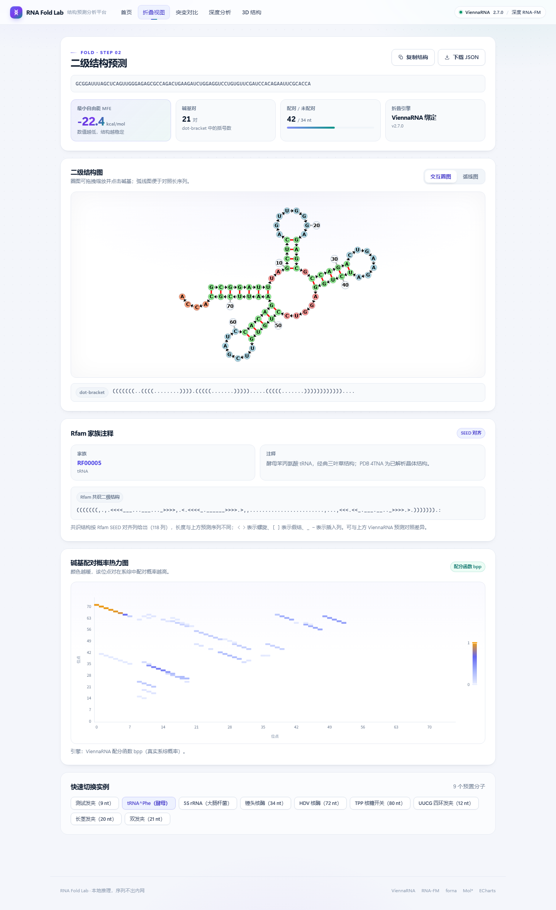
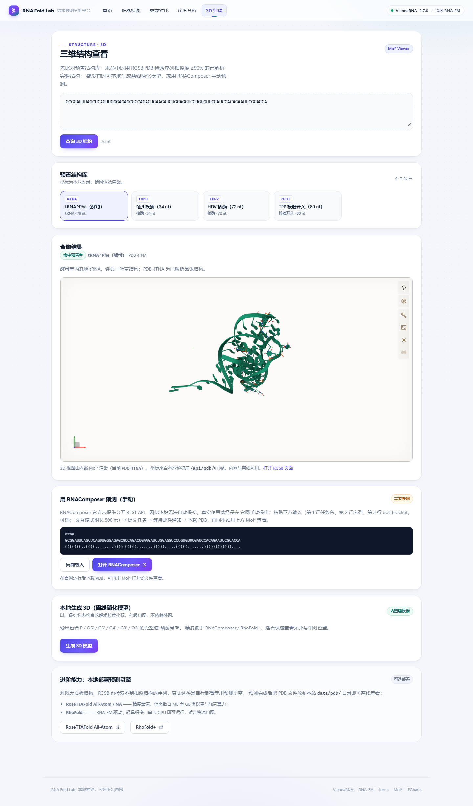

# RNA 结构预测分析平台

输入一段 RNA 序列，秒级得到二级结构、最小自由能（MFE）与碱基配对概率；再对比单点突变的影响、查看深度嵌入表征，或用 Mol* 直接看三维结构。

基于 ViennaRNA（真实热力学能量模型）+ RNA-FM（逐位置嵌入）+ Vue3/Vite，前后端一体，**一条命令即可在本地跑起来**。


---

## 一键启动（推荐）

需要先装好 **Python 3.9+**；如果想让后端直接托管页面（单端口访问），再装 **Node.js 18+**。

**Windows**：双击 `run.bat`，或在命令行执行

```bat
run.bat
```

**macOS / Linux**：

```bash
bash run.sh
```

脚本会自动完成四件事：建虚拟环境 → 装后端依赖 → 首次运行构建前端 → 启动服务。完成后打开：

> **http://127.0.0.1:8000**

首次执行需要联网下载依赖并构建前端（约 3–5 分钟，视网络而定）；之后再启动是秒级。想换端口用 `PORT=9000 bash run.sh`（Windows：`set PORT=9000 && run.bat`）。

> 没装 Node.js 也能跑：脚本会跳过前端构建，API 与 `/docs` 照常可用；装好 Node 后重跑一次即可补齐页面。

---

## 环境要求

| 组件 | 版本 | 是否必需 | 说明 |
|---|---|---|---|
| Python | 3.9+（推荐 3.11） | ✅ 必需 | CI 与 Docker 用 3.11；本机在 3.9 / 3.13 上均实测通过 |
| Node.js | 18+ | 构建前端时需要 | 仅用于打包页面；纯 API 使用可不装 |
| ViennaRNA | 2.7.0（pip wheel） | 可选 | 未安装时自动降级为纯 Python 引擎，能量为估计值 |
| torch + transformers | 见 `requirements-deep.txt` | 可选 | 启用真实 RNA-FM 深度嵌入；不装则用确定性特征嵌入 |

ViennaRNA 的 pip wheel 在 Windows / Linux 的 cp39–cp313 上都有；macOS 若没有对应 wheel 会自动跳过，服务不受影响。

---

## 手动安装（开发模式）

开发时前后端分开跑，前端带热更新（Vite HMR）。

### 1. 后端

```bash
cd RNA-structure-studio        # 换成你 git clone 下来的目录名
python -m venv .venv

# Windows
.venv\Scripts\activate
# macOS / Linux
source .venv/bin/activate

pip install -r requirements.txt
pip install -r requirements-optional.txt   # 可选：真实能量模型
uvicorn backend.main:app --reload --port 8000
```

验证引擎：<http://127.0.0.1:8000/api/health>，`engine` 应为 `viennarna-python`；若显示 `fallback` 说明没装 ViennaRNA，功能可用但能量是估计值。

### 2. 前端

另开一个终端：

```bash
cd RNA-structure-studio/frontend   # 仓库根目录下的 frontend
npm install
npm run dev
```

打开 <http://127.0.0.1:5173>。前端通过 Vite 代理把 `/api` 转发到 `localhost:8000`（见 `frontend/vite.config.js`），**两个端口必须对应**，否则页面会提示「无法连接后端服务」。

### 3. 可选：真实 RNA-FM 深度层

```bash
# 先装 CPU 版 torch，避免拉到几个 GB 的 CUDA 包
pip install torch --index-url https://download.pytorch.org/whl/cpu
pip install -r requirements-deep.txt
```

权重放到 `models/rnafm/`（`pytorch_model.bin` + `config.json`，约 398 MB，已被 `.gitignore` 排除），完全离线可用；缺失时会尝试从 `hf-mirror.com` 拉取 `multimolecule/rnafm`。

已实测组合：`torch 2.5.1+cpu` + `transformers 4.46.3` + `multimolecule 0.0.8`，`/api/health` 返回 `deep_engine: "rna-fm"`，9 nt 嵌入 640 维；76 nt tRNA 首次约 19 s（含加载），缓存命中约 0.5 s。

> 不要放开这两个版本锁：transformers ≥ 4.56 要求 torch ≥ 2.6 才能加载 `.bin` 检查点；multimolecule 0.2.x 依赖新版 tokenizer 注册接口，会报 `Tokenizer class RnaTokenizer does not exist` 并静默降级。

---

## 功能一览

| 页面 | 能做什么 |
|---|---|
| 首页 | 序列输入（FASTA 感知、DNA 的 T 自动转 U、简并碱基与限长校验）、实时 nt/GC 统计、9 个示例一键跳转 |
| 折叠视图 | MFE / 碱基对数 / 配对比例指标卡；**forna 交互圈图**（可拖拽缩放，失败自动回退弧线图）；**弧线图**（长序列友好）；ECharts 配对概率热力图；Rfam 家族注释与共识结构；复制 dot-bracket、下载 JSON |
| 突变对比 | 位点滑杆 + A/U/G/C 选择器 + 局部上下文预览；ΔMFE 结论卡（更稳定 / 更不稳定）；野生型 / 突变型双结构图；断裂与新增碱基对；出结果后自动计算 RNA-FM 嵌入偏移 |
| 深度分析 | 逐位置嵌入（PCA 轨迹 + 嵌入强度曲线）、突变嵌入偏移条形图、WT/MT 嵌入空间对比；异步任务进度、排队位置、取消、导出 JSON |
| 3D 视图 | 命中预置库 → 内嵌 **Mol\* Viewer**（坐标优先读本地，断网可用）；未命中 → RCSB PDB 序列相似度检索（≥90%），点卡片即切换；也可用当前二级结构**本地生成粗粒度 PDB** 并即时预览 |

全站统一浅色设计系统，390 px 起的移动端可用；未知路由有 404 空态页；后端不可达或 5xx 时右下角弹出提示。

<p align="center">
  
  
</p>

---

## 三分钟上手

1. 首页粘贴一段序列（或点示例卡片上的「折叠」）→ 回车或点「预测二级结构」。
2. 折叠页看 MFE 与结构图；点「弧线图」可切换长序列更清楚的画法。
3. 顶部进「突变对比」，拖动位点滑杆、选碱基，点「运行对比」看 ΔMFE。
4. 进「3D 结构」：有实验结构的（如 tRNA）直接出 3D；没有就点「生成 3D 模型」用本地建模器出一个拓扑预览。

---

## 接口

| 方法 | 路径 | 说明 |
|---|---|---|
| GET | `/api/health` | 引擎状态、ViennaRNA 版本、各层限长、缓存上限 |
| GET | `/api/examples` | 预置 RNA 示例库（9 个，含 Rfam 注释） |
| POST | `/api/fold` | `{sequence}` → dot-bracket + MFE + 碱基对（≤1000 nt） |
| POST | `/api/pairprob` | `{sequence}` → 配对概率矩阵（≤300 nt，响应 gzip 压缩） |
| POST | `/api/mutate` | `{sequence, position, base}` → ΔMFE + 配对差异 |
| POST | `/api/tertiary` | `{sequence}` → 预置 PDB 命中 / RCSB 相似结构 / RNAComposer 输入 |
| GET | `/api/pdb/{pdb_id}` | 本地预置 PDB 坐标（离线查看）；未收录 404，非法 ID 400 |
| POST | `/api/3d/predict` | `{sequence, structure?}` → `{job_id}`（异步，≤500 nt） |
| GET | `/api/3d/jobs/{job_id}` | 建模任务状态 / 阶段 / 结果（引擎、缓存、耗时、原子数） |
| DELETE | `/api/3d/jobs/{job_id}` | 取消建模任务（已结束返回 409） |
| GET | `/api/3d/models/{model_id}` | 下载缓存的 PDB 模型 |
| POST | `/api/deep/embed` | `{sequence}` → `{job_id}`（逐位置嵌入，异步，≤300 nt） |
| POST | `/api/deep/mutate` | `{sequence, position, base}` → `{job_id}`（嵌入偏移） |
| GET | `/api/deep/jobs/{job_id}` | 任务状态 / 进度 / 排队位置 / 结果 |
| DELETE | `/api/deep/jobs/{job_id}` | 取消深度任务（已结束返回 409） |

完整交互式文档：<http://127.0.0.1:8000/docs>。

序列统一支持 FASTA（忽略 `>` / `;` 描述行）；含 IUPAC 简并碱基（N/R/Y…）或非法字符时返回 400 并说明原因。

---

## 配置（环境变量）

| 变量 | 默认值 | 说明 |
|---|---|---|
| `RNA_CORS_ORIGINS` | `*` | 允许的前端来源，逗号分隔；生产建议收紧 |
| `RNA_LOG_LEVEL` | `INFO` | 后端日志级别 |
| `RNA_MAX_SEQ_LEN` | `1000` | 实时折叠限长 |
| `RNA_BPP_MAX_LEN` | `300` | 真实配对概率矩阵限长 |
| `RNA_BOLTZMANN_MAX_LEN` | `200` | 降级引擎配对概率限长 |
| `RNA_FALLBACK_MAX_LEN` | `300` | 纯 Python 折叠降级限长 |
| `RNA_MAX_DEEP_LEN` | `300` | 深度分析限长 |
| `RNA_CACHE_MAX_FILES` | `500` | 嵌入缓存文件上限（按最近读取 LRU 淘汰） |
| `RNA_TERTIARY_RATE_LIMIT` | `30` | `/api/tertiary` 每 IP 每分钟上限；`0` 关闭 |
| `RNA_TRUST_PROXY` | `0` | 设为 `1` 时从 `X-Forwarded-For` 取真实 IP；仅在反向代理之后启用，直连公网必须保持 `0` |
| `RNA_CACHE_DIR` | `data/cache` | 缓存根目录（嵌入与 3D 模型） |
| `RNA_3D_CACHE_DIR` | `$RNA_CACHE_DIR/models3d` | 3D 模型缓存目录 |
| `RNA_MAX_3D_LEN` | `500` | 本地 3D 建模限长 |
| `RNA_3D_TIMEOUT` | `600` | 外部 3D 引擎单任务超时（秒） |
| `RNA_3D_CMD` | 未设置 | 外部 3D 引擎命令模板，占位符 `{seq_file}` / `{ss_file}` / `{out_pdb}` / `{workdir}`；失败自动回退内置建模 |
| `HF_ENDPOINT` | `https://hf-mirror.com` | 拉取 RNA-FM 权重的镜像地址，可换成官方或自建镜像 |
| `WEB_CONCURRENCY` / `UVICORN_WORKERS` | 未设置 | 必须 ≤1：任务表 / 限流 / 检索缓存是进程内状态，多进程会在启动时报错 |

---

## 折叠引擎三级降级

| 级别 | 引擎 | 何时生效 | 能量 | 配对概率 |
|---|---|---|---|---|
| 1 | ViennaRNA Python 绑定（`import RNA`） | pip 装好 wheel | 真实 kcal/mol | 配分函数 bpp（真实系综概率） |
| 2 | ViennaRNA CLI（`RNAfold`） | PATH 中可检测到 CLI | 真实 kcal/mol | 降级采样 |
| 3 | 纯 Python Nussinov + Boltzmann 采样 | 无 ViennaRNA | 估计值（非 kcal/mol） | 采样估计 |

pip 的 Windows wheel 只含 Python 绑定（无 `RNAfold.exe`），因此主引擎直接用 Python API；CLI 与纯 Python 作为兜底。

---

## 本地 3D 建模

不依赖外网与第三方服务，把「序列 + dot-bracket」当作几何约束求解粗粒度坐标：

1. **环形初值**：按 5.9 Å/nt 骨架周长反推半径（上限 40 Å），嵌套越深越向内收并抬高，避免平面塌缩，也避免长序列摊成又大又扁的网；
2. **位置约束松弛**（Gauss-Seidel 迭代）：碱基对目标 10.4 Å、相邻残基 5.9 Å、叠加极小回拉项防止漂移；
3. **完整糖-磷酸骨架**：每残基输出 `P` / `O5'` / `C5'` / `C4'` / `C3'` / `O3'`（Mol\* 的核酸卡通表示依赖 `O3'` 走向与 `C3'` 方向），原子沿 P–P 弦做小半径螺旋排布，相邻间距约 1.2–1.7 Å，并写入 `REMARK SIMPLIFIED RNA MODEL`。

实测 76 nt tRNA：碱基对平均 10.5 Å（最大 11.0 Å）、骨架平均 5.9 Å，456 个原子，Rg≈30 Å，秒级完成。

> 它是**教学与拓扑预览级模型**，不是物理精确的三维结构，不能替代 RNAComposer / RhoFold+ 的原子级预测。含伪结（`[]` `{}` `<>`）时交叉配对会一并纳入距离约束建模，但简化模型无法表达真实伪结拓扑，结果页会给出提示。

要接真实引擎，设置命令模板即可（失败自动回退内置建模，并在结果里返回 `fallback` 说明）：

```bash
# macOS / Linux
export RNA_3D_CMD="simrna -s {seq_file} -o {workdir} ; convert {workdir}/model.pdb {out_pdb}"
```

```powershell
# Windows PowerShell
$env:RNA_3D_CMD = "simrna -s {seq_file} -o {workdir} ; convert {workdir}/model.pdb {out_pdb}"
```

---

## 预置示例库

| 名称 | 类型 | 长度 | MFE (kcal/mol) | PDB | Rfam |
|---|---|---|---|---|---|
| 测试发夹 | 合成 | 9 | −1.2 | — | — |
| tRNA^Phe（酵母） | tRNA | 76 | −22.4 | 4TNA | RF00005 |
| 5S rRNA（大肠杆菌） | rRNA | 120 | −50.9 | — | RF00001 |
| 锤头核酶 | 核酶 | 34 | −8.1 | 1HMH | RF00008 |
| HDV 核酶 | 核酶 | 72 | −33.6 | 1DRZ | RF00094 |
| TPP 核糖开关 | 核糖开关 | 80 | −21.6 | 2GDI | RF00059 |
| UUCG 四环发夹 | 合成 | 12 | −5.5 | — | — |
| 长茎发夹 | 合成 | 20 | −18.6 | — | — |
| 双发夹 | 合成多分支 | 21 | −5.8 | — | — |

> 真实分子的序列取自 RCSB PDB 官方 FASTA（1HMH / 1DRZ / 2GDI），结构与 MFE 由 ViennaRNA 预测；表中数值与实测逐条一致。
> `rfam.consensus` 是 Rfam SEED 对齐的共识二级结构（按对齐列，长度与序列不同；`< >` 螺旋、`[ ]` 假结），在折叠页与预测结果对照展示。PDB 坐标已收录在 `data/pdb/`，3D 页可离线打开。

---

## 测试

```bash
pip install -r requirements-dev.txt
python -m pytest tests -q          # 后端：72 项，约 2–3 秒

cd frontend
npm test                           # 前端：5 项（Node 内置测试器）
npm run build                      # 构建产物，顺带做语法校验
```

后端测试覆盖折叠 / 配对概率 / 突变 / 深度任务 / 缓存淘汰 / RCSB 检索 / 限流 / 本地 PDB / 示例注释 / 3D 建模与伪结；不加载真实 RNA-FM 权重、不访问网络。CI（`.github/workflows/ci.yml`）在 Python 3.11 + Node 18 上跑后端测试、前端测试与构建。

---

## Docker 部署（单容器）

```bash
# 默认：ViennaRNA + 前端，深度层用确定性降级嵌入
docker compose up --build -d

# 启用真实 RNA-FM：构建时装 CPU 版 torch（镜像约 +200 MB），并挂载本地权重
docker compose build --build-arg INSTALL_DEEP=1
docker compose up -d
```

容器内 FastAPI 同时提供 `/api/*` 与 `frontend/dist` 静态页面，访问 <http://localhost:8000> 即可。

- **非 root**：容器内以 `app`（uid 10001）运行，`HEALTHCHECK` 内置；
- **挂载**：`./data` 只读、`./models` 只读，嵌入缓存写入命名卷 `rna-cache`（`/app/cache`），避开 bind mount 属主问题；
- **优雅关闭**：`stop_grace_period: 30s`，关闭时自动取消未完成的深度任务；
- **单进程约束**：任务表 / 限流窗口 / RCSB 缓存都在进程内存，容器固定 `--workers 1`；
- **镜像追溯**：`GIT_COMMIT=$(git rev-parse --short HEAD) docker compose build` 把 commit 写进 OCI `LABEL`。

---

## 常见问题

**端口 8000 被占用？**
换端口起：`PORT=8001 bash run.sh`（Windows `set PORT=8001 && run.bat`），或 `uvicorn backend.main:app --port 8001`。注意开发模式还要同步改 `frontend/vite.config.js` 里的代理目标。

**页面提示「无法连接后端服务」？**
开发模式下后端没起来，或代理端口不是 8000。先访问 `http://127.0.0.1:8000/api/health` 确认。

**MFE 是估计值 / 引擎显示 fallback？**
没装 ViennaRNA。`pip install -r requirements-optional.txt` 后重启；没有 wheel 的平台（如部分 macOS）只能用降级引擎。

**3D 区域显示「没能创建 WebGL 画布」？**
浏览器关了硬件加速、或在远程桌面 / 虚拟机里。打开硬件加速后刷新；也可以直接下载 PDB，用 PyMOL、ChimeraX 或 Mol\* 官网看。

**长时间序列（>400 nt）为什么没有圈图？**
forna 圈图节点数随长度线性增长，1000 nt 要渲染 2200 个节点、耗时接近一分钟。超过 400 nt 会自动切到弧线图并禁用圈图按钮。

**pip / npm 太慢？**

```bash
pip install -r requirements.txt -i https://pypi.tuna.tsinghua.edu.cn/simple
npm config set registry https://registry.npmmirror.com
```

**想离线部署？**
把 `models/rnafm/`（权重）和 `data/pdb/`（坐标）一起带上，前端已构建在 `frontend/dist`；运行时不需要外网，只有 RCSB 检索会联网（失败会自动降级并给出提示）。

---

## 目录结构

```text
RNA-structure-studio/          # 仓库根目录
├── run.sh / run.bat           # 一键启动（建环境 → 装依赖 → 建前端 → 起服务）
├── backend/
│   ├── main.py                # FastAPI 接口 + 静态页面托管
│   ├── rna_fold.py            # 折叠引擎（绑定 / CLI / 纯 Python 三级）
│   ├── rna_fm.py              # RNA-FM 深度层（真实模型 / 降级嵌入、异步任务、缓存）
│   ├── rna3d.py               # 本地 3D 建模（约束松弛 + 外部引擎钩子 + 缓存）
│   ├── rcsb.py                # RCSB PDB 序列相似度检索（公开 Search API，无需 key）
│   └── composer_api.py        # RNAComposer 手动桥接（生成可粘贴的输入文本）
├── data/
│   ├── examples/examples.json # 示例库 + Rfam 注释
│   ├── pdb/                   # 本地 PDB 坐标（4TNA / 1HMH / 1DRZ / 2GDI / 1EHZ）
│   └── cache/                 # 运行期缓存（不入库）：embeddings/、models3d/
├── scripts/prewarm.py         # 演示预热：折叠 + 嵌入 + 补齐 PDB
├── models/rnafm/              # 可选：RNA-FM 本地权重（不入库）
├── frontend/                  # Vue3 + Vite + ECharts + forna + Mol*
├── docs/screenshots/          # README 截图
├── tests/                     # pytest 自动化测试
├── .github/workflows/ci.yml   # CI：后端测试 + 前端测试 + 构建
├── Dockerfile                 # 多阶段：构建前端 + 装 ViennaRNA wheel（非 root）
├── docker-compose.yml         # 单容器（API + 静态页面）
└── requirements*.txt          # 基础 / ViennaRNA / 深度层 / 测试依赖
```

---

## 演示预热（可选）

演示前跑一次，把示例的折叠结果与嵌入向量写进缓存，现场点击基本零等待：

```bash
python scripts/prewarm.py              # 折叠 + 深度嵌入 + 补齐缺失 PDB
python scripts/prewarm.py --skip-deep  # 只预热折叠与 PDB（无 torch 时更快）
```

逐条打印引擎、维度、耗时；任一条失败退出码为 1。实测本机 9 条示例约 40 秒（真实 RNA-FM，640 维）。

---

## 已知边界

- **RNAComposer 无法自动提交**：官方没有公开 REST API，也没有 API key。本站生成可粘贴的输入文本，真实途径是到官网手动提交、等邮件回传 PDB，再回本站用 Mol\* 查看。
- **本地 3D 建模是拓扑预览级**：想要原子级精度请接 RhoFold+ / SimRNA（用 `RNA_3D_CMD`）或 RNAComposer。SimRNA 仅学术许可且禁止再分发；RhoFold+ 官方环境锁 Python 3.7 / torch 1.10，建议独立容器接入。
- **Rfam 注释随示例库静态维护**：目前只覆盖 5 个预置真实分子，不联网查询。
- **RCSB 检索固定 ≥90% 相似度**、内存 LRU 100 条，外网不可达时自动降级为手动桥接。

## 许可

见 [LICENSE](LICENSE)。
